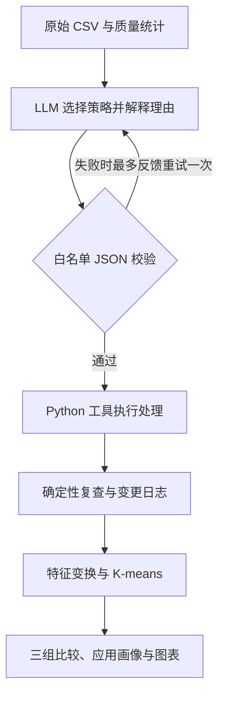

# Google Play 应用数据质量智能体

《数据仓库与数据挖掘》课程小组项目。对 Google Play 应用主表进行质量检查，由大语言模型选择受约束的清洗策略，调用 Python 工具处理与复查，再用 K-means 生成应用画像，并与最低必要处理、固定规则两组基线比较。

**已完成三组全量实验，提供源码、原始与处理后数据、模型调用记录及离线复现入口。** 正式结果来自 2026-10-26 的一次 DeepSeek 真实调用；人工业务复核及课程终稿材料仍待完成。

[正式结果](results/run_/20261026_225712_978517/) · [比较表](results/run_/20261026_225712_978517/comparison.csv) · [图表目录](results/run_/20261026_225712_978517/figures/) · [模型运行记录](results/run_/20261026_225712_978517/agent_status.json)

## 实验结果

| 处理方式 | 清洗保留数 | 参与聚类数 | 聚类保留率 | 选定 k | 轮廓系数 |
| --- | ---: | ---: | ---: | ---: | ---: |
| 最低必要处理 | 10,840 | 7,729 | 71.29% | 3 | 0.3483 |
| 固定规则 | 10,357 | 10,357 | 95.54% | 3 | 0.4178 |
| DeepSeek 智能体 | 10,357 | 8,892 | 82.02% | 3 | 0.3665 |

聚类保留率的分母均为原始 **10,841** 条记录。清洗档案可以保留暂不参与聚类的记录，因此“清洗保留数”不等于“参与聚类数”。轮廓系数在各组固定抽样的 1,500 条记录上计算；三组样本构成不同，**不能按这列分数直接判断哪种处理方式更优**。


三组均隔离 1 条错位记录；固定规则和智能体均去除 483 条完全重复的多余记录。智能体选择不填补评分，将去重后 1,465 条评分缺失记录保留在清洗档案、排除出聚类；对 1,526 条大小未观测记录使用同类别中位数代理，其中 1,468 条最终进入聚类。

在 **7,424 条共同完整记录**上，使用相同特征变换、统一 k=4 重拟合，三对分群的 ARI 均为 1，变换后特征最大差均为 0。它说明这部分共同样本的分群一致，不能证明缺失值被正确恢复，也不能证明智能体优于固定规则。证据见[共同记录比较](results/run_/20261026_225712_978517/common_group_ari.csv)。

智能体组形成的三类画像如下，簇编号没有业务排序：

| 簇 | 记录数 | 评分中位数 | 评论数中位数 | 安装量下界中位数 | 价格中位数（USD） | 群体特征 |
| --- | ---: | ---: | ---: | ---: | ---: | --- |
| 0 | 4,712 | 4.3 | 60,695.5 | 5,000,000 | 0.00 | 评论数和安装量相对较高 |
| 1 | 3,693 | 4.2 | 122 | 10,000 | 0.00 | 评论数和安装量相对较低 |
| 2 | 487 | 4.4 | 291 | 5,000 | 3.99 | 付费特征较突出 |

详细数值见[簇画像](results/run_/20261026_225712_978517/agent/cluster_profiles.csv)，每簇距离中心最近的 3 条记录见[代表应用](results/run_/20261026_225712_978517/agent/representative_apps.csv)。这些画像描述历史快照中的采集记录，不代表当前市场，也不解释应用走红的因果关系。

## 快速开始

使用 **Python 3.12**。以下命令在 Windows PowerShell 执行，无需激活虚拟环境；原始数据已随仓库提供。

```powershell
git clone https://github.com/zjw-buaa/Data-Mining-Group-Project.git
cd Data-Mining-Group-Project
python -m venv .venv
.\.venv\Scripts\python.exe -m pip install -r requirements.lock.txt
.\.venv\Scripts\python.exe -m unittest discover -s tests -v
.\.venv\Scripts\python.exe replay_recorded_run.py --no-figures
```

最后一条命令从原始 CSV 重跑三组处理与聚类，核对留存的模型请求、响应和执行计划，比较 **39 份 CSV（忽略耗时列）**。成功时输出 `status: verified`，新建的 `results/replay_*/` 内保存 `replay_verification.json`。此过程不需要密钥、不联网调用模型，是**既有模型决策的离线复现**，不是新增的一次模型实验。

如需同时重绘并核对 9 张图及其灰度预览，运行：

```powershell
.\.venv\Scripts\python.exe replay_recorded_run.py
```

完整回放还要求 18 张 PNG 逐像素一致，因此依赖版本、中文字体和绘图环境也需匹配；跨电脑优先使用 `--no-figures` 核对数值。已有 PNG、SVG 及图注可直接查看；下载仓库后打开正式结果目录下的 `figures/图表面板.html` 可浏览全部图表。

2026-10-27 的本地复核已通过锁定依赖安装、10 项测试及完整回放：39 份 CSV 除耗时外一致，18 张 PNG 逐像素一致，新增 API 调用为 0。见[回放核验记录](logs/replay_verification_20261027.json)。

macOS/Linux 可用 `python3 -m venv .venv` 创建环境，并将上述解释器路径替换为 `.venv/bin/python`；图像像素一致性仍受字体与平台影响。

### 其他运行方式

```powershell
# 真实数据小样本检查：前800条和末400条，仅运行基线，不生成正式图
.\.venv\Scripts\python.exe run.py --smoke --agent off

# 全量重新运行两组基线，不调用模型
.\.venv\Scripts\python.exe run.py --agent off

# 发起新的真实 DeepSeek 实验：脚本在本机以隐藏输入方式读取密钥
powershell.exe -NoProfile -ExecutionPolicy Bypass -File .\run_deepseek.ps1
```

新的模型实验可能产生费用并选择不同计划。本次留存模型为 `deepseek-flash`，关闭思考模式，输出上限 4,096 token；实际调用 1 次，输入 1,180、输出 232 token。原始费用字段为未知，包内费用估算不是账户实际扣费。

其他兼容服务可设置 `LLM_BASE_URL`、`LLM_MODEL`、`LLM_API_KEY` 后运行 `run.py --agent required`，需要支持 Chat Completions 的 JSON 对象响应。`.env.example` 仅供参考，程序不会自动加载 `.env`。密钥只在本机配置，不写入仓库或分享日志。

`--agent auto` 在未配置模型时仅完成两组基线；`--agent required` 在模型未完成时返回退出码 2，并保留已完成的基线结果。新运行默认写入独立目录，`results/latest_run.txt` 指向最近一次全量流水线输出；`--out` 指定的目录必须为空。

## 数据与处理方法

来源为 [Google Play Store Apps（lava18 / Kaggle）](https://www.kaggle.com/datasets/lava18/google-play-store-apps)，使用 `data/raw/googleplaystore.csv`，共 **10,841 条记录、13 个字段**，不接入评论表。一行是一条应用采集记录，`App` 不是经验证的唯一标识；`source_row_id` 是从 1 开始的数据记录序号。

原始文件保持不变，程序运行前校验 SHA256；换用其他版本 CSV 会拒绝运行：

```text
3e438f48161961933d26e99a8d9fc8ed79edfaa9fb34f8838e1ab4ec7a9fab91
```

| 质量问题 | 检查与处理 |
| --- | --- |
| 缺失值 | 原始评分缺失 1,474 条，原因未知。保留观测缺失与插补标记，按各组策略决定使用代理值或排除出聚类 |
| 重复数据 | 按原始 13 列识别 483 条完全重复的多余记录；同名但属性不同的记录保留，另列复核清单 |
| 异常或噪声 | 隔离 `source_row_id=10473` 的错位记录（如 `Rating=19`），保留原值和错误原因；不因数值大删除合法热门或高价应用 |
| 类型或格式不一致 | `19M → 19 MB`、`201k → 0.201 MB`；安装量去逗号与 `+` 后作为下界；价格解析为美元；日期转为 ISO 格式 |

`Varies with device` 保留为特殊状态，观测大小仍为空；中位数只作为建模代理，不等于真实大小。非聚类字段的缺失继续保留并纳入质量报告。

<details>
<summary>13 个原始字段</summary>

| 字段 | 含义 |
| --- | --- |
| `App` | 应用名称 |
| `Category`、`Genres` | 商店类别与细分类标签 |
| `Rating` | 评分，按 0–5 范围校验 |
| `Reviews` | 评论数量 |
| `Size` | 安装包大小或随设备变化等特殊状态 |
| `Installs` | 安装量档位下界，不是精确下载次数 |
| `Type`、`Price` | 免费／付费类型与美元价格 |
| `Content Rating` | 内容适龄分级 |
| `Last Updated` | 采集时记录的最近更新日期 |
| `Current Ver`、`Android Ver` | 应用版本与最低 Android 版本要求 |

</details>

### 智能体与对照设计



模型只接收统计与少量样例，选择是否去重、如何处理评分与大小缺失，不生成或执行任意代码。异常隔离、格式解析及工具行为由代码确定；处理后进行有限值、值域等检查。**当前实现没有在处理后自动发起新一轮模型规划**；本次真实调用也未触发计划校验重试。

| 组别 | 完全重复 | 评分缺失 | 大小未观测 |
| --- | --- | --- | --- |
| 最低必要处理 | 保留 | 排除出聚类 | 排除出聚类 |
| 固定规则 | 去重 | 全局中位数代理 | 全局中位数代理 |
| 本次智能体计划 | 去重 | 排除出聚类 | 同类别中位数代理；该类别有效观测不足 20 条时回退全局中位数 |

聚类使用评分、评论数、大小、安装量下界和价格 5 个特征。除评分外先做 `log1p`，再使用同一批有效、去重、完整参考记录拟合的 `StandardScaler` 统一缩放。各组比较 k=2–6，以固定抽样的轮廓系数选 k；`random_state=42`、`n_init=10`、`max_iter=300`、`tol=1e-4`，计算限制为单线程。共同记录另以 k=4、种子 42/52/62 检查分群与种子稳定性。

## 仓库与输出

```text
├── run.py / src/              # 质量处理、模型计划、聚类与流水线
├── replay_recorded_run.py      # 留存真实模型计划的离线复现
├── run_deepseek.ps1            # 本机真实模型运行入口
├── requirements*.txt          # 依赖范围与本次锁定版本
├── tests/ / utils/             # 测试、绘图与复现工具
├── data/                      # 原始CSV、来源与数据许可
├── results/                   # 正式结果、图表及后续新运行
├── logs/                      # 交付方的验证记录
└── docs/                      # 历史方案与交接资料
```

以下路径均相对正式运行目录 `results/run_/20261026_225712_978517/`：

| 产物 | 内容 |
| --- | --- |
| `quality_before.json`、各组 `quality_after.json` | 处理前后质量统计 |
| 各组 `cleaned.csv`、`quarantine.csv`、`changes.csv` | 清洗档案、隔离记录、变更理由与前后值 |
| 各组 `clusters.csv`、`cluster_profiles.csv`、`representative_apps.csv` | 分群、画像和代表应用 |
| `comparison.csv`、`common_*.csv` | 原生样本结果、共同记录比较与稳定性 |
| `logs/pipeline.jsonl`、`agent_status.json` | 提示词、模型响应、工具调用与计划状态 |
| `run_manifest.json`、`复现清单.json`、`shared_scaler.json` | 输入与源码哈希、依赖、参数、缩放参考及复现命令 |
| `figures/` | 9 张 PNG/SVG、灰度预览及图注 |
| `人工抽查12项_三组对照_待复核.csv` | 四类问题各 3 项的三组人工抽查表 |

回放严格校验原始 CSV 和核心源码哈希；请使用与该运行配套的版本。修改核心源码后应生成新的运行记录，不能将新代码视为旧模型实验的一部分。历史自动说明中的“模型尚未运行”等待办已过时，当前进度以本 README、实际状态文件和比较表为准。运行与阅读本说明不依赖 `docs/`。

## 验收边界与收尾

技术产物已经齐备，仍有以下收尾事项：

- **人工业务复核**：填写[12 项三组抽查表](results/run_/20261026_225712_978517/人工抽查12项_三组对照_待复核.csv)中的判断、疑问与复核人；目前人工栏为空。发现问题后修正、重新运行并更新结果。
- **课程终稿**：仓库尚未见最终报告（不超过 10 页）、展示 PPT（汇报 7 分钟、问答 3 分钟）及四位成员的实际贡献说明；如另存于组内共享位置，应在提交前收齐。
- **结论边界**：仅有一次真实模型计划，未评估多次模型决策稳定性；共同完整样本不验证插补真值。若要进一步声称智能体更优，需要另行设计支持该结论的实验。

数据由 Lavanya / lava18 发布，随包保留 [CC BY 3.0 数据许可](data/LICENSE.txt)和[来源说明](data/数据来源说明.txt)。

## 团队

| 成员 | 职责分工 |
| --- | --- |
| 闫灿宇 | 项目范围与实验结果审阅 |
| 周静雯 | 数据准备、说明与报告整理 |
| 戴想然 | 技术方案、智能体实现与实验 |
| 赵思嘉 | 数据处理策略、结果抽查与解释 |
