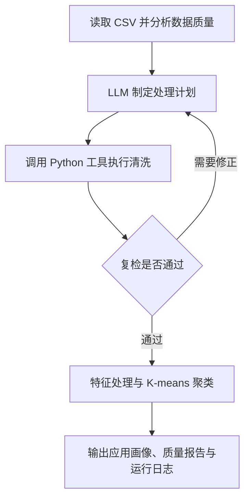

# Google Play 应用数据质量智能体

《数据仓库与数据挖掘》课程小组项目，旨在构建一个能够自主分析数据质量、制定并执行预处理方案的智能体，并通过聚类形成应用画像：不同应用群体在评分、安装量、评论数、价格和大小上有哪些差异？

**当前进度：已确定 Google Play 选题与技术方案，尚未发布可运行代码、数据文件或实验结果。** 以下介绍项目范围与计划实现的方法。

## 数据来源与范围

使用 [Google Play Store Apps（lava18 / Kaggle）](https://www.kaggle.com/datasets/lava18/google-play-store-apps) 的主表 `googleplaystore.csv`，也可从[公开 CSV 镜像](https://raw.githubusercontent.com/jasonchang0/kaggle-google-apps/master/google-play-store-apps/googleplaystore.csv)获取。原始版本包含 **10,841 条记录、13 个字段**，满足课程不少于 5,000 条记录、10 个字段的要求。

每行是一条应用信息记录，包含重复与异常；本项目仅使用主表，不接入用户评论表。下载后需核对字段、记录数和数据版本，并保留未经修改的原始文件。

| 字段 | 含义与使用方式 |
| --- | --- |
| `App` | 应用名称，用于展示代表应用；同名不一定是同一条记录 |
| `Rating` | 平均评分，满分 5 分；缺失不等于 0 分 |
| `Reviews` | 用户评论数量，拟用于聚类 |
| `Installs` | 安装量档位或下限，如 `10,000+`，不是精确下载次数 |
| `Price`、`Type` | 美元价格及免费／付费类型 |
| `Size` | 安装包大小，包含不同单位及“随设备变化”等特殊状态 |
| `Category`、`Genres` | 商店类别与细分类标签，用于解释群体特征 |
| `Content Rating` | 内容适龄分级 |
| `Last Updated` | 数据采集时记录的最近更新日期 |
| `Current Ver`、`Android Ver` | 应用版本号与最低 Android 版本要求 |

数据是历史快照。聚类用于描述样本中的群体差异，不代表当前应用市场，也不能证明应用走红的原因。

## 四类数据质量问题

| 问题 | 数据中的典型表现 | 处理原则 |
| --- | --- | --- |
| 缺失值 | `Rating` 中存在 `NaN` | 统计缺失比例，结合字段语义选择插补或保留缺失标记，不直接填 0 |
| 重复数据 | 完全重复行；同名但属性不同的应用记录 | 完全重复行去重；同名记录结合其他字段核验，有歧义时标记复核 |
| 异常值或噪声 | `Rating=19`，并伴随字段错位 | 结合值域与相邻字段检查，无法可靠还原的记录隔离并保留原值，不强行修正 |
| 类型或格式不一致 | `Size` 混用 `19M`、`201k`、`Varies with device`；安装量带逗号和 `+`；价格带 `$` | 大小统一为 MB，安装量解析为档位下限，价格转为数值；特殊状态单独标记，不当作 0 |

这些示例用于说明检查与处理策略，具体问题数量以实际导入后的统计为准。所有修改保留处理理由及前后对照，不确定的修复交由人工确认。

## 智能体工作流

由 **LLM 负责决策与解释，Python 工具负责统计、清洗和聚类计算**。智能体依据质量检查结果选择处理方法，并利用复检反馈修正方案。



聚类初始特征为评分、安装量档位、评论数、价格和大小。对长尾数值做适当的对数变换和缩放，比较不同簇数的轮廓系数与多次运行稳定性，再结合应用类别解释各群体、列出代表应用，不预设分群结论。

## 实验与评估

计划对比三种处理方式，检查智能体是否带来可解释的数据质量与下游任务改善：

| 对照组 | 处理方式 |
| --- | --- |
| 最低必要处理 | 仅进行保证聚类可运行所需的类型转换和必要缺失处理 |
| 固定规则处理 | 使用预先设定的清洗规则，不根据本轮复检结果调整策略 |
| 智能体处理 | 根据质量统计制定方案、调用工具，并依据复检结果修正 |

三组使用相同原始数据、特征定义、聚类算法、簇数候选及随机种子设置；如清洗改变了样本范围，需说明删除、隔离与保留数量及可比较的范围。

- **数据质量**：四类问题处理前后的数量、样本保留情况，以及处理记录的人工抽查结果。
- **聚类效果**：轮廓系数、多次运行稳定性和群体可解释性，结合评价，不以单个指标判断优劣。
- **执行开销**：运行耗时、模型调用次数与成本，同时记录错误和修正过程。

## 获取与复现

目前可以获取项目说明，并从上面的数据来源下载主表：

```bash
git clone https://github.com/zjw-buaa/Data-Mining-Group-Project.git
cd Data-Mining-Group-Project
```

仓库暂未提供依赖文件和运行入口，尚不能执行智能体或复现实验。代码发布时将补充实际环境版本、依赖安装、数据路径、模型配置、运行命令及输出位置。

计划随实现提供以下产物：

- **数据与质量报告**：清洗后的 CSV、问题统计、处理前后对照及隔离记录；保留原始数据或提供获取方式。
- **聚类与对照结果**：应用分群、群体画像、代表样本，以及三组实验的指标和图表。
- **复现与运行记录**：数据版本、特征处理和聚类参数、随机种子，以及模型名称、提示词、参数、调用次数、成本、工具调用和错误修正记录。公开日志需移除密钥与敏感信息。

## 团队

| 成员 | 职责分工 |
| --- | --- |
| 闫灿宇 | 项目范围与实验结果审阅 |
| 周静雯 | 数据准备、说明与报告整理 |
| 戴想然 | 技术方案、智能体实现与实验 |
| 赵思嘉 | 数据处理策略、结果抽查与解释 |
