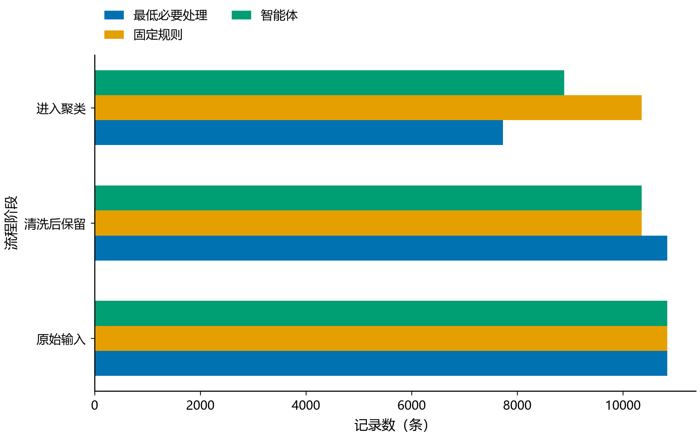

# Google Play 应用数据质量智能体

《数据仓库与数据挖掘》课程项目：检查 Google Play 应用数据中的缺失、重复、异常和格式问题，让大语言模型选择清洗策略，再用 K-means 分析应用画像，并与两组基线比较。

**三组全量实验已完成，智能体组使用过一次真实 DeepSeek 调用。** 本仓库保留原始数据、可运行源码、最终结果和调用证据；人工抽查及课程报告、PPT 仍需收尾。

[最终结果](results/final/) · [三组比较](results/final/comparison.csv) · [图表](results/final/figures/) · [真实模型记录](results/final/agent_status.json)

## 实验怎么做

**原始数据 → 质量检查 → 模型选择策略 → Python 清洗与检查 → 聚类与三组比较 → 人工抽查。**

模型读取质量统计和少量样例，决定是否去重、如何处理缺失评分和未知大小；Python 按这些决定执行，检查数值是否合法。模型不负责计算聚类，也不生成代码。本次是“一次选方案、工具执行和检查”，尚未实现清洗后让模型反复修改方案的循环。

三组都统一数据格式，并隔离 1 条字段错位记录，区别如下：

| 处理方式 | 完全重复的记录 | 缺少评分 | 不知道应用大小 |
| --- | --- | --- | --- |
| 最低必要处理 | 保留 | 不参与聚类 | 不参与聚类 |
| 固定规则 | 去重 | 用全表评分中位数填补 | 用全表大小中位数填补 |
| 本次模型选择 | 去重 | 不参与聚类 | 用同类别大小中位数填补¹ |

¹ 同类别有效大小不足 20 条时，改用全表中位数。中位数就是把数值排序后取中间值。

`Varies with device` 表示“大小随设备变化”，不代表大小为零。例如同类别的中位数是 20 MB，可以暂用 20 MB 参加聚类，但不能说该应用真实大小就是 20 MB；原始内容、未知状态和填补标记都会保留。评分缺失记录也会留在清洗档案中，是否参加聚类由上表决定。同名但属性不同的应用不会直接当作重复删除。

聚类使用**评分、评论数、大小、安装量下界、价格**五项信息。先压缩跨度很大的数值，再统一尺度，避免安装量等大数字主导分组；每组尝试分成 2–6 类，最终均选出 3 类。

## 实验得到什么

数据共 **10,841 条、13 个字段**，其中评分缺失 1,474 条，完全重复的多余记录 483 条。只使用应用主表，不使用评论表。

| 处理方式 | 清洗后保留 | 参加聚类 | 占原始记录比例 | 轮廓系数 |
| --- | ---: | ---: | ---: | ---: |
| 最低必要处理 | 10,840 | 7,729 | 71.29% | 0.3483 |
| 固定规则 | 10,357 | 10,357 | 95.54% | 0.4178 |
| DeepSeek 智能体 | 10,357 | 8,892 | 82.02% | 0.3665 |



**这些结果说明清洗策略会改变参与聚类的样本，不能直接证明智能体更优。** 三组轮廓系数来自各自的样本，不能据此简单排名。在 7,424 条共同完整记录上，固定分成 4 类重新比较，三组分群完全一致（ARI=1）；这一检查也不能证明填补值等于真实值。

智能体组的三类应用画像如下。数字为各簇的中位数，簇编号没有优劣顺序。

| 簇 | 记录数 | 主要特征 |
| --- | ---: | --- |
| 0 | 4,712 | 评论约 6.07 万、安装量下界 500 万，规模相对较大 |
| 1 | 3,693 | 评论 122、安装量下界 1 万，规模相对较小 |
| 2 | 487 | 价格 3.99 美元，付费特征较突出 |

查看[完整画像](results/final/agent/cluster_profiles.csv)和[各簇代表应用](results/final/agent/representative_apps.csv)。这些结果描述历史数据中的记录，不代表当前市场或应用走红的原因。图表中的中心图、PCA 图展示的是**固定规则组**，具体口径见[图注](results/final/figures/图表说明.md)。

## 怎样运行

只想了解结论，可以直接阅读上面的结果和图表，无需运行程序。要重新做一次真实模型实验，使用 **Python 3.12**，在 Windows PowerShell 执行：

```powershell
git clone https://github.com/zjw-buaa/Data-Mining-Group-Project.git
cd Data-Mining-Group-Project
python -m venv .venv
.\.venv\Scripts\python.exe -m pip install -r requirements.lock.txt
powershell.exe -NoProfile -ExecutionPolicy Bypass -File .\scripts\run_deepseek.ps1
```

最后一步会提示输入 DeepSeek API Key，输入不显示、不写入文件。程序真实调用模型并运行三组实验，可能产生 API 费用；新结果保存到 `results/run_/` 下的新目录，终端会显示具体路径。模型新选的方案可能与仓库结果不同。程序内置校验本仓库原始 CSV 的版本，不能直接替换为其他数据文件。

<details>
<summary>可选：不调用模型，复算仓库留存的结果</summary>

安装依赖后运行：

```powershell
.\.venv\Scripts\python.exe run.py --replay
```

它沿用已保存的真实模型方案，**从原始 CSV 重新清洗和聚类**，核对最终数据与统计，成功时显示 `verified`。这不是重新展示旧文件，也不是新增一次模型实验。它不需要密钥、不联网，输出保存在 `results/replay/`；无需重绘或逐像素比较图片。

</details>

<details>
<summary>技术参数与开发检查</summary>

- 除评分外的四项特征先做 `log1p`；三组共用在去重、完整、有效的原始记录上拟合的 `StandardScaler`。
- K-means：候选 k=2–6，种子 42，`n_init=10`、`max_iter=300`、`tol=1e-4`，单线程；按每组固定抽样的 1,500 条记录计算轮廓系数选 k。
- 共同记录检查：k=4，种子 42/52/62；具体参数和版本保存在 [run_manifest.json](results/final/run_manifest.json)。
- 留存实验使用 `deepseek-flash`，关闭思考模式，输出上限 4,096 token；实际调用 1 次，输入 1,180、输出 232 token。调用日志未提供实际费用。
- 开发检查：`python -m unittest discover -s tests -v`。运行参数见 `python run.py --help`，回放参数见 `python run.py --replay --help`。
- macOS/Linux 安装后可使用 `.venv/bin/python`；配置 `LLM_BASE_URL`、`LLM_MODEL`、`LLM_API_KEY` 三个环境变量，再执行 `python run.py --agent required` 调用真实模型。程序不自动读取 `.env`。

</details>

## 文件在哪里

| 位置 | 用途 |
| --- | --- |
| `run.py`、`scripts/` | 运行入口、真实模型启动脚本、离线复算 |
| `src/`、`utils/` | 数据处理、模型决策、聚类及必要绘图工具 |
| `tests/` | 处理规则与复算检查的测试 |
| `data/` | 原始 CSV、来源说明和数据许可 |
| [`docs/`](docs/) | 历史方案、课程要求与交付资料，按需查阅 |
| [`results/final/`](results/final/) | 本次已审核保留的正式实验 |

正式结果中，`minimum/`、`fixed/`、`agent/` 分别保存三组清洗数据、处理记录和聚类结果；根目录保存比较表、质量统计与模型调用证据；`figures/` 保存 9 张正式 PNG 和图注。历史方案与交付资料保留在 `docs/`，阅读项目和运行程序可直接按本页操作。后续运行结果默认只保存在本地，确认后再整理为正式版本。

## 提交前还要做什么

- **人工复核**：填写[12 项三组抽查表](results/final/人工抽查12项_三组对照_待复核.csv)。它是实验后的质量验收：检查是否误删、单位换算是否正确、缺失处理是否合理；不参与模型选方案和本次自动计算。目前人工栏仍为空，发现问题需修正后重新实验。项目尚未记录人工耗时，不能据此量化“节省了多少人工工作量”。
- **课程材料**：完成不超过 10 页的最终报告、7 分钟汇报 PPT（另有 3 分钟问答）和实际贡献说明。
- **结论范围**：目前只有一次真实模型方案，尚未检验多次模型决策的稳定性，也没有缺失值真值用于验证填补准确性。

数据来源：[Lavanya / lava18 的 Google Play Store Apps](https://www.kaggle.com/datasets/lava18/google-play-store-apps)。保留 [CC BY 3.0 数据许可](data/LICENSE.txt)及[来源说明](data/数据来源说明.txt)。一行是一次采集记录，应用名称不是经验证的唯一标识；安装量是档位下界。

团队分工：闫灿宇（范围与结果审阅）、周静雯（数据、说明与报告）、戴想然（技术实现与实验）、赵思嘉（策略、抽查与解释）。
